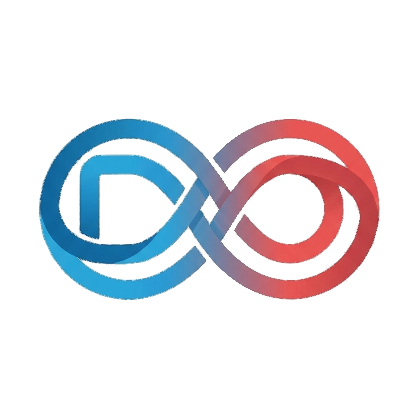

  

  <h1>Enterprise-grade software, delivered at startup speed.</h1>

  

    DuniaOps is a London-based software and DevOps consultancy. We design, build and operate modern software for organisations that need to move fast, pairing senior engineers with AI-accelerated delivery from first prototype to production.
  

  

    <a href="https://www.duniaops.com"><strong>Website</strong></a>
    ·
    <a href="https://www.duniaops.com/blog"><strong>Insights</strong></a>
    ·
    <a href="https://www.linkedin.com/company/duniaops"><strong>LinkedIn</strong></a>
    ·
    <a href="mailto:info@duniaops.com"><strong>Contact</strong></a>
  

## What we do

| Service | How we help |
| --- | --- |
| [AI-accelerated software development](https://www.duniaops.com/services/ai-software-development) | Move from discovery and prototypes to dependable production software with senior engineering oversight. |
| [Booking and resource allocation platforms](https://www.duniaops.com/services/booking-and-allocation-systems) | Build scheduling, availability, payments, reminders, dashboards and operational integrations around your business. |
| [Mobile app development](https://www.duniaops.com/services/mobile-app-development) | Deliver reliable mobile products from product definition and UX through launch and ongoing improvement. |
| [Software consultancy and team augmentation](https://www.duniaops.com/services/software-consultancy) | Strengthen architecture, delivery planning and engineering teams, or recover projects that have lost momentum. |
| [DevOps and cloud consultancy](https://www.duniaops.com/services/devops-and-cloud-consultancy) | Improve CI/CD, infrastructure as code, cloud platforms, observability, reliability and cost control. |

## Technology areas

- **Product engineering:** web applications, APIs, mobile apps and internal platforms
- **AI-assisted delivery:** discovery, prototyping, implementation and production readiness
- **Cloud and DevOps:** AWS, Azure, Google Cloud, Terraform, Docker, Kubernetes and CI/CD
- **Operational systems:** booking, scheduling, resource allocation, payments, reminders and dashboards
- **Engineering leadership:** architecture reviews, technical due diligence, delivery planning and project recovery

## How we work

- Senior engineers stay close to every engagement.
- We work across the full delivery lifecycle, from discovery to production.
- We favour clear ownership, maintainable systems and practical handover.
- We support clients in the UK and worldwide from London.

## Start a conversation

Have a software, AI, mobile or cloud delivery challenge?

- Visit [duniaops.com](https://www.duniaops.com)
- Email [info@duniaops.com](mailto:info@duniaops.com)
- Follow [DuniaOps on LinkedIn](https://www.linkedin.com/company/duniaops)

DuniaOps Solution and Consulting Ltd · Established in 2018 · London, United Kingdom
